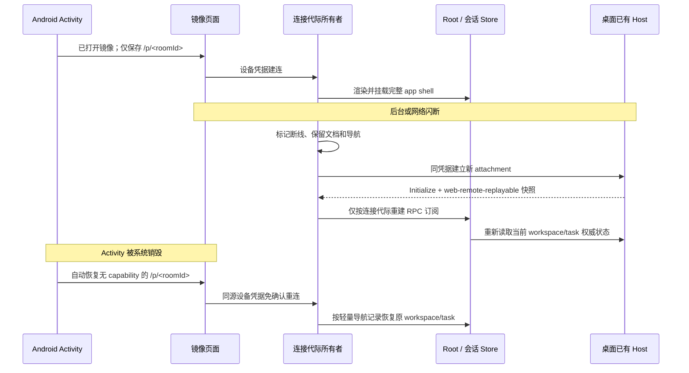

# Android 原页面恢复与手机附件选择

## 目标与范围

- 手机镜像已连接后，网络断开或后台挂起不得通过 `window.location.reload()` 重建整个文档；当前工作区、任务、输入草稿和已渲染界面保持挂载，恢复 `web-remote-replayable` 服务后重新读取权威快照。
- Android Activity 被系统销毁后，若此前已进入工作区，则自动回到上次的本机或镜像页面；镜像恢复地址不含一次性 capability。首次使用或用户明确回到选择页时，仍停留选择页。
- 手机本机页面和通过现有 `MIRROR` 导航白名单进入的页面均可调用系统文件选择器；外部网页、非 HTTPS 页面及伪造路径仍拒绝。文件字节经现有附件上传链路交给当前 workspace Host，不把整个手机文件系统暴露给电脑或远端网页。
- 桌面 Main、已有 Host attachment、Worker 协议、owner/lease 和凭据校验不变；不以隐藏 loading 代替连接恢复，不引入第二 Agent 或第二任务事实源。

## 所有者与不变量

1. `MobilePairingGate` 是镜像连接代际的唯一所有者：初连、断线重试和最终失败各自只有一个当前 generation；迟到结果不得覆盖新连接或清理新凭据。断线时保留已挂载 app shell，按服务代际重建 `Root` 的 RPC 订阅，不重新加载文档。连接失败只显示非阻塞提示与重试入口，不把已有界面替换为配对页。
2. `Root` / `TabStore` 继续拥有 workspace 导航，`useLCodeSessionStore` 继续拥有任务选择。镜像轻量恢复记录只保存导航标识（workspace、activeTask、设置页），不是业务状态副本；重连优先保留内存状态，冷启动从该记录恢复，不新建任务。记录由 web 入口读写，原生容器不解析任务内容。
3. `MainActivity` 只持久化恢复所需的 URL 形状，不保存 capability、设备凭据或 token。原生运行时准备好以后最多发起一次自动恢复；启动异步结果以当前 Activity 为界，用户明确返回选择页会取消自动恢复。
4. `UrlPolicy` 是页面可信性判定入口。系统文件选择器只接受当前 WebView 的 `IN_APP` 或 `MIRROR` 页面，并在选择结果返回时再次检查；不能因为页面曾经受信就允许它导航到外部后继续读取手机文件。
5. 凭据仍只由 `pairingCredentialStore` 管理。只有明确 `auth` / `revoked` 可清理；busy、网络错误、房间停止/过期不得删除授权。

## 事件顺序

## 验收

- 真实浏览器中，镜像连接后断开数据 WebSocket：不发生 `load` / `beforeunload`，连接状态提示出现，已渲染导航锚点保留，重连后服务请求使用新代际；busy/网络错误有界重试，明确吊销仍清理凭据。
- 已连接页面记录 activeTask 后，模拟进程销毁重新创建文档：免 capability 重连，恢复原 workspace/task；草稿任务不得被历史 task 抢占。
- Android 原生恢复在本机、镜像、回选择页、端口变化四种情况下均符合 URL 白名单；不会把 capability 写入 SharedPreferences。
- Android 本地及 HTTPS `/p/<roomId>` 页面可打开 SAF；外链 HTTPS、HTTP、伪造 `/p/` 路径、失配 WebView 和选择后已离开受信页面时拒绝。系统选择器图片和文档选择结果回传 WebView，并经真实页面进入现有附件上传链路。
- 执行 `pnpm typecheck`、`pnpm lint`、changed 架构检查、远程控制回归、Android JUnit / lint / assemble；模拟器断线、Activity 重建与文件选择分别报告。物理手机未连接时不得冒充真机验收。
